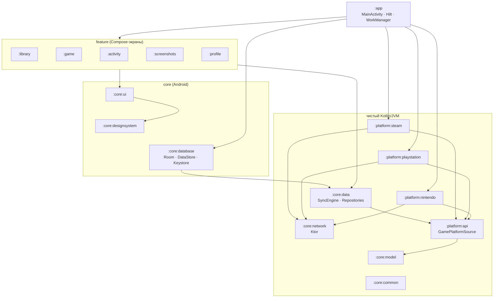

<div align="center">

# 🎮 Playlog

**Личный трекер игрового времени для Android: Steam, PlayStation и Nintendo в одной библиотеке.**


-3DDC84?logo=android&logoColor=white)


[Возможности](#-возможности) · [Платформы](#-платформы-и-данные) · [Архитектура](#-архитектура) · [Сборка](#-сборка) · [Тесты](#-тесты-и-качество) · [Агенты](#-работа-с-claude-code)

</div>

---

Playlog собирает **время в играх, названия, обложки и скриншоты** со всех ваших аккаунтов и показывает их как одну библиотеку: что вы сейчас проходите, сколько играли за неделю, на какой платформе провели больше всего часов.

> [!NOTE]
> Это **личный некоммерческий проект**. Приложение читает только *ваши собственные* данные. Для PlayStation и Nintendo используются неофициальные (реверс-инжиниринговые) API их же мобильных приложений, поэтому они могут сломаться без предупреждения. Приложение не публикуется в магазинах и никак не связано с Valve, Sony или Nintendo.

## ✨ Возможности

| | |
|---|---|
| 📚 **Библиотека** | Все игры с трёх платформ в одной сетке обложек 3:4, поиск, фильтр по платформе, сортировка, карточка «Сейчас играю». |
| 🕹️ **Карточка игры** | Hero-арт, общее время, последний запуск, прогресс достижений или трофеев, разбивка по платформам, график за 14 дней, скриншоты. |
| 📈 **Активность** | Неделя / месяц / год: итог, дельта к прошлому периоду, стек-столбики по платформам и топ-5 игр. |
| 🖼️ **Скриншоты** | Галерея снимков, сгруппированных по дням и играм, полноэкранный просмотр и ручной импорт. |
| 🔗 **Подключение аккаунтов** | Пошаговый вход для каждой платформы; токены забираются из WebView автоматически, без копирования руками. |
| 🔄 **Фоновая синхронизация** | WorkManager обновляет данные по расписанию; история «сколько играл за период» строится из снимков даже там, где API её не отдаёт. |
| 🔐 **Секреты на устройстве** | Ключи и refresh-токены шифруются AES-GCM ключом из Android Keystore и никуда не уходят. |
| 🌙 **Тёмная тема** | Material 3, лаймовый акцент, шрифты Manrope и Inter, цвета платформ в бейджах и графиках. |

## 🖼️ Скриншоты

> Кликабельные макеты всех экранов: **[дизайн Playlog](https://claude.ai/artifact/AZEG69DvDHTHHofjVL5wEL)**.

| Библиотека | Карточка игры | Активность | Скриншоты |
|:---:|:---:|:---:|:---:|
| _скоро_ | _скоро_ | _скоро_ | _скоро_ |

<!-- Положите PNG в docs/screenshots/ и замените «скоро» на  и т. д. -->

## 🌐 Платформы и данные

| |  |  |  |
|---|:---:|:---:|:---:|
| Общее время по играм | ✅ | ✅ | ✅ |
| Первый / последний запуск | ✅ | ✅ | ✅ |
| Время за последние 2 недели | ✅ | — | — |
| Время по дням | — | — | ✅ |
| Достижения / трофеи | ✅ | ✅ | — |
| Обложки | ✅ CDN Steam | ✅ PS5, у PS4 не всегда | квадратная иконка (SteamGridDB/IGDB в планах) |
| Скриншоты пользователя | ✅ Steam Cloud | ✅ | ручной импорт |
| Вход | API key + SteamID / ник | NPSSO → OAuth | Nintendo Account (PKCE) → session token |
| API | официальный Web API | неофициальный (PS App) | неофициальный (Nintendo apps) |

Подробная спецификация эндпоинтов, схем ответов, сроков жизни токенов и рисков лежит в общей папке проекта (`data-sources/SPEC.md`), рядом с PoC-клиентами и фикстурами.

## 🏗️ Архитектура

Многомодульный Gradle-проект. Домен, сетевые клиенты платформ и синхронизация написаны на **чистом Kotlin/JVM** и собираются и тестируются без Android SDK; UI и хранение данных живут в Android-модулях.



| Модуль | Что внутри |
|---|---|
| `:app` | Точка входа, навигация, DI-граф (`AppModule`), `SyncWorker` и планировщик синка. |
| `:feature:*` | Экраны на Compose + ViewModel: `library`, `game`, `activity`, `screenshots`, `profile` (аккаунты и подключение). |
| `:core:designsystem` | Тема `PlaylogTheme`, цвета платформ, кнопки, плитки, графики, загрузка обложек (Coil). |
| `:core:ui` | Общие элементы списков и форматтеры времени. |
| `:core:database` | Room-база, DataStore-настройки, `KeystoreCredentialStore`. |
| `:core:data` | `SyncEngine`, репозитории, расчёт активности, интерфейсы хранилищ и их in-memory реализации. |
| `:core:model` | Доменные модели: `Game`, `LibraryEntry`, `Account`, `Screenshot`, `Activity`, `GameStatus`. |
| `:core:network` | Фабрика Ktor-клиента и обработка ошибок платформ. |
| `:core:common` | Диспетчеры, часы, утилиты корутин. |
| `:core:testing` | Фейки, фикстуры, контрактные тесты хранилищ, `MainDispatcherRule`, `requireEnv` для live-тестов. |
| `:platform:api` | Контракт платформы: `GamePlatformSource`, `AccountLinker`, `CredentialStore`, `PlatformException`. |
| `:platform:steam` · `:playstation` · `:nintendo` | Клиенты конкретных платформ: авторизация, DTO, маппинг в доменные модели. |

**Как добавить платформу:** создать `:platform:<name>`, реализовать `GamePlatformSource` (объявив `capabilities`) и `AccountLinker`, зарегистрировать источник в `AppModule`. Остальное приложение работает только с интерфейсом.

## 🛠️ Сборка

**Нужно:** Android Studio (актуальная стабильная), JDK 17, Android SDK 36.

```bash
git clone https://github.com/Rainboom7/gametracker.git
cd gametracker
./gradlew :app:installDebug        # собрать и поставить debug-сборку на устройство
```

Либо откройте папку в Android Studio и запустите конфигурацию `app`. Debug-сборка ставится рядом с release как `app.playlog.debug`. Release для личного использования подписывается debug-ключом, если не настроен свой keystore.

Без Android SDK можно собрать и протестировать только JVM-часть:

```bash
./gradlew test -Pplaylog.jvmOnly=true
```

## 🧪 Тесты и качество

| Команда | Что делает |
|---|---|
| `./gradlew test` | Unit-тесты всех модулей: клиенты платформ на Ktor `MockEngine` с фикстурами, ViewModel, фильтры, Room-хранилища (Robolectric). |
| `./gradlew liveTest` | `*LiveTest` против настоящих серверов. Без переменных окружения тесты пропускаются. |
| `./gradlew detekt` | Статический анализ. Старые находки лежат в `config/detekt/baseline/`, падают только новые. |
| `./gradlew koverHtmlReport` | Сводный отчёт о покрытии в `build/reports/kover/html/`. |

Переменные для live-тестов: `STEAM_API_KEY`, `STEAM_ID`, `PSN_NPSSO`, `NSO_SESSION_TOKEN`. Никогда не коммитьте их и не кладите в фикстуры.

## 🤖 Работа с Claude Code

В репозитории лежит конфигурация для [Claude Code](https://claude.com/claude-code):

- [`CLAUDE.md`](CLAUDE.md): устройство проекта, команды сборки и тестов, соглашения по коду.
- [`.claude/agents/`](.claude/agents): субагенты под роли проекта.

| Агент | Когда звать |
|---|---|
| `android-developer` | Фичи и багфиксы в Compose, ViewModel, Hilt, Room, WorkManager. |
| `ui-ux-designer` | Экраны и компоненты по дизайн-спецификации, тема, доступность. |
| `platform-reverse-engineer` | Эндпоинты, авторизация и DTO Steam / PSN / Nintendo, обложки, фикстуры. |
| `test-engineer` | Тесты, фикстуры, контрактные тесты, detekt, kover. |

## 📄 Лицензии

Шрифты [Manrope](licenses/OFL-Manrope.txt) и [Inter](licenses/OFL-Inter.txt) распространяются по SIL Open Font License 1.1. Steam, PlayStation и Nintendo являются товарными знаками своих владельцев.
